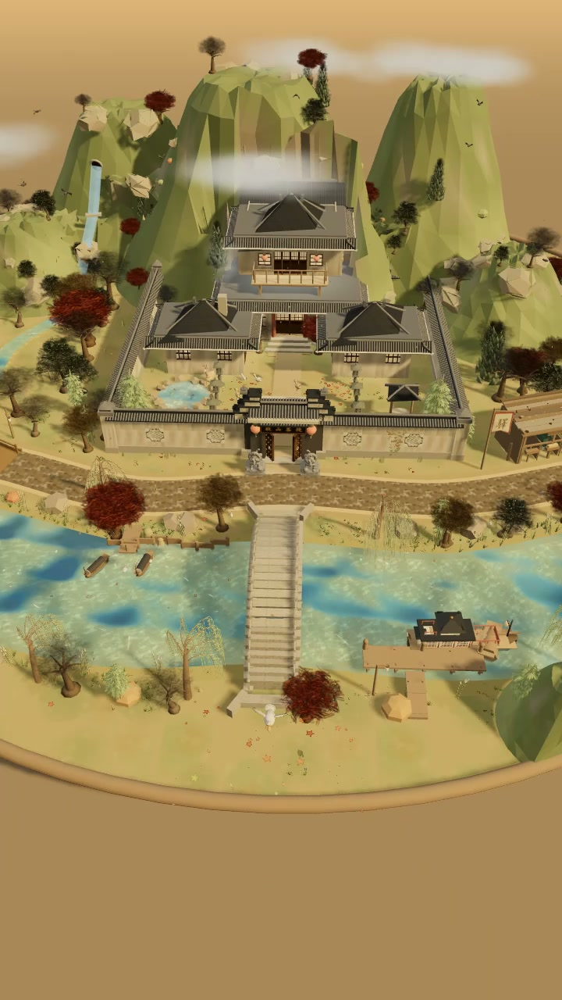

# 秋山客栈 · 3D 沙盘

一个运行在浏览器中的中式客栈 3D 沙盘，由 Three.js 实时渲染，模型资产使用 Blender 制作并导出为 GLB。



## 项目特性

- 约 60 米直径的圆形沙盘，包含客栈、院墙、门楼、河道、石桥、码头和低多边形群山。
- 上午、下午、上半夜、下半夜四套光照环境，支持连续昼夜过渡。
- 自动环绕、自由旋转、缩放和平移视角。
- 实时水面、反射、焦散、植被摆动、马车、船只和动物行为。
- 可触发的雷阵雨天气，包括雨丝、闪电、乌云和积水。
- 鹈鹕模式：第三人称探索、游泳、上桥、进入建筑、拾取金币、购买饰品和燃放烟花。
- 场景资产同时提供 GLB 和 base64 离线版本，可本地双击运行。

## 技术栈

- Three.js r147
- Blender
- 原生 HTML / CSS / JavaScript
- WebGL

## 运行方式

### 直接打开

双击 `index.html`，使用 Chrome、Edge 或 Firefox 打开。GLB 资产会在本地自动切换到 base64 离线版本。

### 本地服务器

```bash
python -m http.server 8000
```

然后访问 `http://localhost:8000`。

### GitHub Pages

仓库为纯静态站点，可直接在 GitHub Pages 中发布根目录。

## 操作

| 操作 | 功能 |
| --- | --- |
| 鼠标左键拖拽 | 旋转视角 |
| 鼠标滚轮 | 缩放 |
| 鼠标右键拖拽 | 平移视角 |
| `WASD` | 鹈鹕模式下移动 |
| `Shift` | 鹈鹕模式疾跑或疾飞 |
| `Space` | 跳跃、滑翔或浮潜 |
| `F` | 开关门或进入商店 |
| 方向键 | 鹈鹕模式调整视角 |

## URL 参数

- `?phase=am|pm|n1|n2`：指定上午、下午、上半夜或下半夜。
- `?cycle=1`：启动滚动昼夜。
- `?angle=0-3`：切换初始机位象限。
- `?shot=top&grid=1`：正交俯视与坐标网格。
- `?fly=gate|fall`：播放项目内置航拍路线。

## 目录

```text
.
├─ index.html
├─ main.js
├─ assets/          # GLB 模型、纹理与离线 base64 资源
├─ vendor/          # Three.js 与官方示例模块
└─ docs/
   └─ preview.jpg
```

## 说明

- 公开仓库只保留运行所需资产，不包含 Blender 源文件和渲染预览缓存。
- GLB 模型由 Blender 制作并导出。
- Three.js 及其官方示例模块遵循各自的 MIT 许可，见 `THIRD_PARTY_NOTICES.md`。

## 作者

GitHub：[@Mitsuasa513](https://github.com/Mitsuasa513)

## License

项目代码以 MIT License 发布，详见 `LICENSE`。第三方组件和资产的许可说明见 `THIRD_PARTY_NOTICES.md`。
